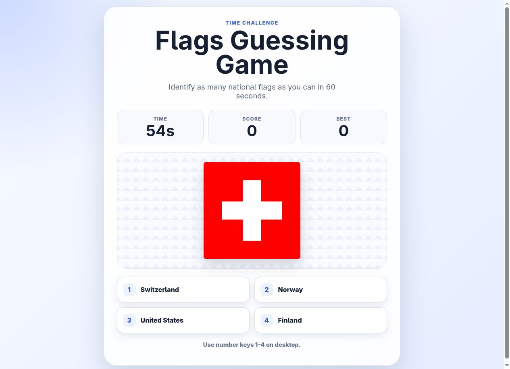

<div align="center">

# Flags Guessing Game

Guess the country from its flag. You have 60 seconds to answer as many as you can.

Play in your browser with a mouse, touchscreen, or keyboard.

[](https://react.dev/)
[](https://www.typescriptlang.org/)
[](https://vite.dev/)
[](https://bun.sh/)

[How to play](#how-to-play) · [Quick start](#quick-start) · [Build & deploy](#build--deploy) · [Under the hood](#under-the-hood)

<br>



<sub>Gameplay with a local sample dataset.</sub>

</div>

<br>

| Time limit | Answers | Saved score |
| :--- | :--- | :--- |
| 60 seconds per game. | Four shuffled choices, with feedback after each guess. | Your best score is saved in this browser. |

## How to play

1. Wait for the flags to load, then select Start.
2. Click or tap the country that matches the flag. You can also press 1, 2, 3, or 4.
3. A correct guess adds one point. Wrong guesses don't subtract points. The game shows the correct answer before moving to the next flag.
4. When time runs out, you'll see your score, total guesses, accuracy, and best score. Select Play Again to start another game.

Flags are shuffled and won't repeat until you've gone through the pool. You don't need an account. Your best score is stored locally, so clearing site data resets it.

## Quick start

Install [Bun](https://bun.sh/), then:

```sh
git clone https://github.com/Abdirrahman/Flags-Game.git
cd Flags-Game
bun install --frozen-lockfile
bun dev
```

Open the URL printed in your terminal, usually http://localhost:5173. The project has been tested with Bun 1.3.14.

> [!IMPORTANT]
> REST Countries has [retired](https://restcountries.com/docs/countries/legacy-api-deprecation) the v3.1 endpoint this game uses. Live flag loading won't work until the app is migrated to a supported API. The screenshot uses local sample data.

## Build & deploy

```sh
bun run build     # Check TypeScript and create the production build
bun run preview   # Preview the build locally
```

The preview server usually runs at http://localhost:4173. To deploy the game, publish the contents of `dist/` to a static web host. The app runs in the browser and doesn't need a backend.

The development and preview servers listen on all network interfaces. You can use either to test from another device on the same network.

## Under the hood

<details>
<summary><strong>Flag data & loading</strong></summary>

<br>

The app requests country names and flag image URLs from REST Countries. It keeps countries marked as independent and removes duplicate names. It tries to preload each SVG flag, then the PNG if the SVG fails. Countries whose images can't load are left out.

At least 20 flags must load before you can start. Loading stops after 10 seconds if it hasn't finished, and the game shows a Retry button on failure. Opening or reloading the game requires internet access to the country API and image hosts. Once the flags have loaded, the app generates rounds locally.

The API endpoint is in [`src/App.tsx`](src/App.tsx).

</details>

<details>
<summary><strong>Dependency maintenance</strong></summary>

<br>

When you update dependencies, commit `bun.lock` so other installations use the same versions. Before pushing, run:

```sh
bun audit
bun run build
```

[Dependabot](.github/dependabot.yml) checks for Bun dependency updates once a week.

</details>

<details>
<summary><strong>Project map</strong></summary>

<br>

| File | Purpose |
| :--- | :--- |
| [`src/App.tsx`](src/App.tsx) | Data loading, rounds, scoring, timer, and game screens |
| [`src/styles.css`](src/styles.css) | Responsive layout and visual feedback |
| [`src/main.tsx`](src/main.tsx) | React entry point |
| [`CONTEXT.md`](CONTEXT.md) | Gameplay terminology |
| [`docs/adr/`](docs/adr/) | Architectural decisions and challenge scope |

</details>
